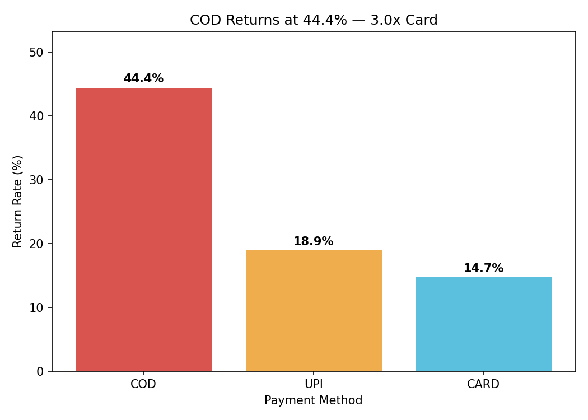
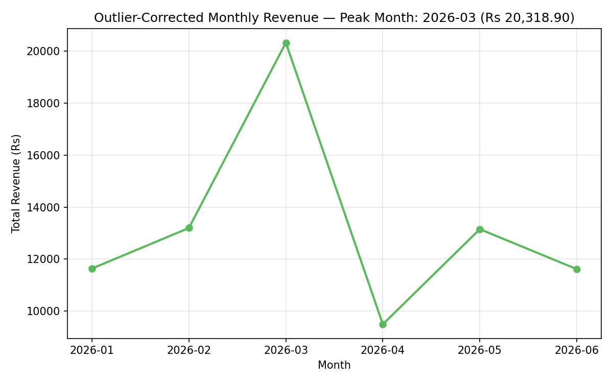

# Mamaearth Orders Analytics: SQL, Python and GenAI Narrator

An end-to-end analytics project built on three raw CSV files (customers, products, orders).
It loads the data into a PostgreSQL database and reports on it with SQL (Part 1), cleans
and analyses it with Python and pandas (Part 2), and turns the verified numbers into a
written business report using the Gemini API, with a fully offline fallback (Part 3).

Follow this README from top to bottom and you will reproduce every number in the project.

---

## Table of contents

1. [Project overview](#1-project-overview)
2. [Repository structure and how the layers connect](#2-repository-structure-and-how-the-layers-connect)
3. [Prerequisites](#3-prerequisites)
4. [Quick start](#4-quick-start)
5. [Part 1: SQL database and reports](#5-part-1-sql-database-and-reports)
6. [Part 2: Python data cleaning and analysis](#6-part-2-python-data-cleaning-and-analysis)
7. [Part 3: GenAI insight narrator](#7-part-3-genai-insight-narrator)
8. [Results at a glance](#8-results-at-a-glance)
9. [Troubleshooting](#9-troubleshooting)
10. [Author declaration](#10-author-declaration)

---

## 1. Project overview

| Part | Tool | What it does | Main output |
|---|---|---|---|
| **1. SQL** | PostgreSQL | Builds a 3-table relational database, loads the CSVs, and answers nine business questions with SQL queries | `sql/reports.sql` |
| **2. Python** | pandas, matplotlib | Cleans the messy data, reconciles it against Part 1, tests hypotheses, finds outliers, and draws two charts | `analysis/clean_and_eda.py`, two PNG charts |
| **3. GenAI** | Gemini API (free tier) | Turns the verified numbers into a Situation, Complication, Resolution business report, with an offline fallback that needs no key | `narrator/generate_narrative.py` |

**The input data** (in `data/`):

| File | Rows | Contents |
|---|---|---|
| `customers.csv` | 45 | customer id, name, city, city tier, signup date, acquisition source |
| `products.csv` | 16 | product id, name, category, price (in Rupees) |
| `orders.csv` | 180 | order id, customer, product, date, quantity, discount, payment method, rating, returned flag |

**The data is deliberately messy.** The raw CSVs contain problems that Part 2 is designed to fix:

| Problem in the raw data | Where it is handled |
|---|---|
| `payment_method` appears in 7 spellings (COD, cod, Card, card, CARD, UPI, upi) | Part 2, Task 2 |
| 5 duplicate orders (O0176 to O0180, a simulated double-submit bug) | Part 2, Task 3 |
| 12 blank `discount_pct` values and 15 blank `rating` values | Part 1 stores them as `NULL`; Part 2, Task 4 fills them |
| 2 extreme bulk orders (quantity 25 and 30) | Part 2, Task 6 |

Part 1 deliberately runs on the **raw, uncleaned** data. Never edit the CSV files.

---

## 2. Repository structure and how the layers connect

### Repository structure

```
mamaearth-returns-growth-pipeline-by-amar/
├── README.md
├── sql/
│   ├── schema.sql
│   ├── seed_data.sql
│   └── reports.sql
├── data/
│   ├── customers.csv
│   ├── products.csv
│   └── orders.csv
├── analysis/
│   ├── clean_and_eda.py
│   └── visualize.py
├── visualizations/
│   ├── return_rate_by_payment.png
│   └── monthly_revenue_trend.png
└── narrator/
    ├── findings.json
    ├── generate_narrative.py
    └── sample_output.txt
```

| Folder | File | Purpose |
|---|---|---|
| `sql/` | `schema.sql` | Part 1, Task 1: creates the three tables |
| | `seed_data.sql` | Part 1, Task 2: loads the CSV data |
| | `reports.sql` | Part 1, Task 3: nine report queries with their outputs |
| `data/` | `customers.csv`, `products.csv`, `orders.csv` | The raw input data, never edited |
| `analysis/` | `clean_and_eda.py` | Part 2: cleaning and analysis; also writes `findings.json` |
| | `visualize.py` | Part 2: draws the two charts (run after `clean_and_eda.py`) |
| `visualizations/` | two `.png` files | The charts produced by `visualize.py` |
| `narrator/` | `findings.json` | Part 3, Task 1: the verified numbers as structured data |
| | `generate_narrative.py` | Part 3: Gemini path, offline path and the number checker |
| | `sample_output.txt` | Part 3: the saved report that the checker is run against |

Files created when you run the code: `analysis/merged_clean.csv` (read by `visualize.py`),
`narrator/findings.json` and the two charts (regenerated each run), and
`narrator/sample_output_offline.txt` (saved by an offline run of Part 3).

### How the three layers connect

```
        data/   customers.csv  +  products.csv  +  orders.csv     (raw, never edited)
                    |                                  |
        loaded into PostgreSQL                 read directly by pandas
                    |                                  |
                    v                                  v
        PART 1: SQL layer                    PART 2: Python layer
        schema.sql, seed_data.sql            clean_and_eda.py
        reports.sql                          cleans, merges, analyses
        raw revenue: Rs 99,860.20            cleaned revenue: Rs 97,358.30
                    |                          |                |
                    |                          |                +--> visualize.py
                    |                          |                       |
                    +---- reconciled <---------+                       v
                    gap Rs 2,501.90                          visualizations/*.png
                    = the 5 duplicate orders
                                               |
                                               v
                                     narrator/findings.json
                                               |
                                               v
                                     PART 3: GenAI layer
                                     generate_narrative.py
                                     key set and call works?  yes: Gemini report
                                                              no:  offline template
                                               |
                                               v
                                     checker: 5 figures present?
                                               |
                                               v
                                     narrator/sample_output.txt
```

| Layer | Reads | Produces | Hands over |
|---|---|---|---|
| **Data** | none | the three raw CSV files | the same files to Part 1 and to Part 2 |
| **Part 1: SQL** | the CSVs, through `seed_data.sql` | the database, nine reports, and the raw revenue total of 99,860.20 | the raw total, used as a benchmark for Part 2 |
| **Part 2: Python** | the CSVs, directly | cleaned data, results, two charts, and `findings.json` | `findings.json` to Part 3 |
| **Part 3: GenAI** | `findings.json` only | a Situation, Complication, Resolution report that passes the five-figure check | the final written deliverable |

Three connections to remember:

1. **Parts 1 and 2 are independent.** They start from the same raw files and can be run in either order. They meet at one check: Part 1's raw total (99,860.20) minus Part 2's cleaned total (97,358.30) equals 2,501.90, exactly the value of the 5 duplicate orders removed in Part 2.
2. **Part 2 feeds Part 3 through one file.** The narrator never touches the CSVs or the database; it only reads `narrator/findings.json`. That is why `python analysis/clean_and_eda.py` must be run before Part 3.
3. **Part 3 cannot invent numbers.** Its instructions restrict the model to the figures in `findings.json`, the checker confirms five key figures appear, and the offline template guarantees them.

---

## 3. Prerequisites

| Needed for | Software | Notes |
|---|---|---|
| Part 1 | **PostgreSQL** with `psql`, or **pgAdmin** | Any recent version |
| Parts 2 and 3 | **Python 3.9 or newer** | |
| Parts 2 and 3 | `pip install pandas matplotlib` | |
| Part 3, online path only | `pip install google-genai` and a free Gemini API key | Optional; the offline path needs neither |

**Important:** run every command in this README from the **repo root folder**, the one
containing `data/`, `sql/`, `analysis/` and `narrator/`. The scripts use relative paths.

---

## 4. Quick start

Copy and paste, in this order, from the repo root:

```bash
pip install pandas matplotlib

# Part 1: SQL
createdb -U postgres mamaearth_project
psql -U postgres -d mamaearth_project -f sql/schema.sql
psql -U postgres -d mamaearth_project -f sql/seed_data.sql
psql -U postgres -d mamaearth_project -f sql/reports.sql

# Part 2: Python (order matters)
python analysis/clean_and_eda.py
python analysis/visualize.py

# Part 3: GenAI narrator (offline path; set GEMINI_API_KEY first for the online path)
python narrator/generate_narrative.py
```

The rest of this README explains each step and the result you should see.

---

## 5. Part 1: SQL database and reports

**Overview.** Part 1 builds a relational database and answers business questions about it
using SQL. It runs on the raw data, exactly as supplied.

| Task | File | What it does |
|---|---|---|
| 1. Schema | `sql/schema.sql` | Creates `customers`, `products` and `orders` with primary keys, foreign keys, `NOT NULL` and `DEFAULT` rules. `discount_pct` and `rating` are deliberately nullable. |
| 2. Seed data | `sql/seed_data.sql` | Loads all 241 rows with `INSERT` statements. Blank cells become true SQL `NULL`. |
| 3. Reports | `sql/reports.sql` | Nine queries (a to i), each with its output written as a comment above it. |

### Step 1: create an empty database

```bash
createdb -U postgres mamaearth_project
```

*In pgAdmin:* right-click **Databases**, choose **Create, then Database**, and name it `mamaearth_project`.

### Step 2: create the tables and load the data

```bash
psql -U postgres -d mamaearth_project -f sql/schema.sql
psql -U postgres -d mamaearth_project -f sql/seed_data.sql
```

*In pgAdmin:* select the database, open **Tools, then Query Tool**, paste the contents of
`schema.sql`, press **F5**, clear the box, then do the same with `seed_data.sql`.

Both files are safe to re-run: `schema.sql` drops and recreates the tables, and `seed_data.sql`
empties them before inserting.

### Step 3: check the load

```sql
SELECT COUNT(*) FROM customers;   -- expect 45
SELECT COUNT(*) FROM products;    -- expect 16
SELECT COUNT(*) FROM orders;      -- expect 180
```

### Step 4: run the reports

```bash
psql -U postgres -d mamaearth_project -f sql/reports.sql
```

*In pgAdmin:* copy one query at a time into the Query Tool and press F5.

| Report | What it asks | Expected result |
|---|---|---|
| a) Order totals | How many orders, total revenue, average order value? | 180 orders, revenue 99,860.20, average 554.78 |
| b) COUNT(\*) vs COUNT(column) | How many orders have no rating? | 180, 165, 15 |
| c) LEFT JOIN with a zero-match row | Which customer has no orders? (checked two ways: LEFT JOIN and NOT IN) | C045 Vihaan, from both queries |
| d) GROUP BY + HAVING | Which cities return more than 20% of orders? | Jaipur (19, 8, 42.1), Lucknow (49, 15, 30.6), Bangalore (33, 8, 24.2) |
| e) Ranking with LIMIT / OFFSET | Top spenders; then ranks 3 to 5 only | C043 12,920.00; C026 8,371.60; C008 4,564.60; C011 4,111.00; C042 3,785.00 |
| f) Three-table JOIN | Revenue by product category | Haircare 44,956.10; Skincare 27,346.00; Babycare 16,805.00; PersonalCare 10,753.10 |
| g) LIKE | Customers whose name starts with A | 10 rows |
| h) DISTINCT | Distinct acquisition sources | Ad, Organic, Referral, Social |
| i) ALTER TABLE + UPDATE with CASE | Add `loyalty_tier` (Gold for tier-1 cities, Silver otherwise) | Gold 28, Silver 17 |

**How revenue is calculated:** `quantity * price * (1 - discount_pct / 100)`, with a blank
discount treated as 0% using `COALESCE`.

**Note:** report (i) adds a column to `customers`. Running `reports.sql` a second time on
the same database fails at that `ALTER TABLE` because the column already exists. To start
clean, re-run `schema.sql` and `seed_data.sql` first.

---

## 6. Part 2: Python data cleaning and analysis

**Overview.** Part 2 is a pandas pipeline that works directly on the raw CSV files. It does
not use the SQL database, so it can be run before or after Part 1.

| Task | What it does |
|---|---|
| 1. Load and inspect | Loads the three CSVs; `orders.shape` is (180, 9) |
| 2. Standardise casing | Turns 7 spellings of `payment_method` into 3: CARD, UPI, COD |
| 3. Remove duplicates | Detects and drops the 5 duplicate orders; shape becomes (175, 9) |
| 4. Fill missing values | Missing discount becomes 0; missing rating becomes the median (3.0) |
| 5. Merge and reconcile | Joins the three tables, computes `order_value`, and explains the gap against Part 1 |
| 6. Outlier detection | IQR rule on `quantity`; two orders are flagged, not dropped |
| 7. Hypothesis test | Does COD have a higher return rate? |
| 8. Segmentation | Return rate by payment method and city tier |
| 9. Correlation | Correlation matrix of rating, returned, discount and quantity |
| 10. Time series | Monthly revenue with and without the outliers |
| 11. Visualisations | Two PNG charts (`analysis/visualize.py`) |

### Step 1: run the cleaning and analysis

```bash
python analysis/clean_and_eda.py
```

The script prints every intermediate result. Check them against this table:

| Task | Expected output |
|---|---|
| 1 | `(180, 9)` |
| 2 | Before: 7 values. After: CARD 70, UPI 55, COD 55 |
| 3 | 5 rows dropped: O0176, O0177, O0178, O0179, O0180. Shape `(175, 9)` |
| 4 | 12 discounts filled with 0; median rating 3.0; 15 ratings filled; no nulls remain |
| 5 | Cleaned total **97,358.30**. This is **2,501.90** less than Part 1's raw 99,860.20, and the 5 dropped duplicate rows sum to exactly 2,501.90. The gap is caused by the duplicates, not by imputation |
| 6 | Q1 = 1.0, Q3 = 2.0, IQR = 1.0, bounds -0.5 and 3.5. Outliers: O0011 (quantity 25) and O0098 (quantity 30) |
| 7 | Return rate: CARD 14.7%, COD 44.4%, UPI 18.9%. Hypothesis **Confirmed** |
| 8 | Highest-risk segment: **COD in Tier-2 cities at 54.5%** (COD in Tier-1 is 37.5%) |
| 9 | All six correlations are negligible (below 0.2). "Higher discounts reduce returns" is **Busted** (about -0.09) |
| 10 | Including outliers, January looks best (29,582.10). Excluding them, January falls to 11,637.10 and **March is the true peak at 20,318.90** |

At the end it also writes two helper files: `analysis/merged_clean.csv` (read by the chart
script) and `narrator/findings.json` (read by Part 3).

### Step 2: draw the charts

```bash
python analysis/visualize.py
```

`visualize.py` reads `analysis/merged_clean.csv`, so **`clean_and_eda.py` must be run first**.
It creates both charts in `visualizations/`.

### Where `narrator/findings.json` comes from

It is written automatically by the final step of `analysis/clean_and_eda.py`, from the
same variables that produced the Part 2 results (including the Task 5 reconciliation
figures). It is never typed by hand, so it cannot drift from the numbers above, and
re-running the script regenerates an identical file.

---

## 7. Part 3: GenAI insight narrator

**Overview.** Part 3 turns the verified numbers in `narrator/findings.json` into a short
business report with three labelled sections: **Situation**, **Complication** and
**Resolution**. The report is written by Google's Gemini model when a key is available,
and by a fixed template when it is not, so the project always runs.

| Task | What it does |
|---|---|
| 1. `findings.json` | The seven verified figures as structured JSON, generated by code |
| 2. `generate_scr_narrative` | Calls Gemini with a system instruction (role, structure, "no invented numbers") and a prompt built from the findings |
| 3. Parameter locking | `temperature=0.0` (a factual report, not creative writing), an explicit `max_output_tokens`, a 20-second timeout, and `try/except` that returns a tidy dict instead of an exception |
| 4. Offline fallback | `generate_scr_narrative_offline` builds the same report from a template, with no network and no key |
| 5. Accuracy checker | Confirms five figures appear in the text and prints PASS or FAIL for each |
| 6. README | This document |

**Run Part 1 and Part 2 first, or at least `python analysis/clean_and_eda.py`**, because
Part 3 reads `narrator/findings.json`.

### Option A: no API key (offline path, nothing to configure)

```bash
python narrator/generate_narrative.py
```

The script notices there is no key, uses the template, and needs no internet. The result
is saved to `narrator/sample_output_offline.txt`.

### Option B: with a free Gemini API key (online path)

1. Open **aistudio.google.com**, sign in, click **Get API key**, then **Create API key**. The free tier needs no payment details.
2. Install the library once: `pip install google-genai`
3. Set the key as an environment variable named `GEMINI_API_KEY`, in the same terminal you will run the script from:

   | System | Command |
   |---|---|
   | macOS / Linux | `export GEMINI_API_KEY="your-key-here"` |
   | Windows PowerShell | `$env:GEMINI_API_KEY="your-key-here"` |
   | Windows Command Prompt | `set GEMINI_API_KEY=your-key-here` |

4. Run the script:

   ```bash
   python narrator/generate_narrative.py
   ```

A successful Gemini run is saved as `narrator/sample_output.txt`, the file the checker is
run against. **Never write your key into a file, and never commit it to GitHub.**

### The accuracy checklist

After every run, the script checks that these five figures appear in the report (commas are
ignored when comparing):

| Figure | Meaning |
|---|---|
| 97,358.30 | cleaned total revenue |
| 44.4 | COD return rate |
| 54.5 | COD plus Tier-2 return rate |
| 2,501.90 | revenue removed with the duplicate orders |
| March with 20,318.90 | the true peak month |

Expected end of output: five `[PASS]` lines and `Overall: ALL CHECKS PASSED`.

### Automatic fallback

If no key is set, **or** the Gemini call fails for any reason (no internet, quota used up,
a retired model name), the script switches to the offline path by itself. Google retires
model names from time to time; if the online path reports an error, edit the
`MODEL_CANDIDATES` list near the top of `narrator/generate_narrative.py`.

---

## 8. Results at a glance

| Question | Answer |
|---|---|
| Cleaned total revenue | **Rs 97,358.30** |
| Raw total revenue | Rs 99,860.20 |
| Why they differ | 5 duplicate orders worth Rs 2,501.90 were removed |
| Return rate by payment method | COD **44.4%**, UPI 18.9%, Card 14.7% |
| Where the return risk is concentrated | COD in Tier-2 cities, **54.5%** (COD in Tier-1: 37.5%) |
| Do discounts reduce returns? | No: the correlation is about -0.09 (negligible) |
| True peak revenue month | **March 2026**, Rs 20,318.90 |
| Why January looked like the peak | Two bulk orders (quantity 25 and 30) landed in January; without them it is Rs 11,637.10 |





---

## 9. Troubleshooting

| Problem | Fix |
|---|---|
| `FileNotFoundError: data/orders.csv` | You are not in the repo root, or the CSVs are not in `data/`. |
| `FileNotFoundError: narrator/findings.json` | Run `python analysis/clean_and_eda.py` first |
| `FileNotFoundError: analysis/merged_clean.csv` | Run `clean_and_eda.py` before `visualize.py` |
| `ModuleNotFoundError: pandas` or `matplotlib` | `pip install pandas matplotlib` |
| `psql: command not found` | Add PostgreSQL's `bin` folder to your PATH, or use pgAdmin's Query Tool instead |
| `psql` asks for a password | Enter the password you chose when installing PostgreSQL |
| `column "loyalty_tier" already exists` | Report (i) was already run. Re-run `schema.sql` and `seed_data.sql` for a fresh start |
| Output says "No GEMINI_API_KEY found... using offline fallback" | Expected when no key is set. The offline report is still correct |
| Output says "Gemini API call failed... using offline fallback" | Check the key, your internet connection, or the model names in `MODEL_CANDIDATES`. The offline report is still correct |

---

## 10. Author declaration

This project presents an end-to-end capstone pipeline that brings together SQL relational
analysis, Python-based data cleaning and exploratory analysis, data visualisation, and
Generative AI narrative generation with a keyless offline fallback.

| | |
|---|---|
| **Author** | Pushpita Sinha |
| **Program** | Data Analytics with AI & GenAI |
| **Institution** | E&ICT Academy, IIT Roorkee |

**Ownership.** I submit this repository as my capstone work and take responsibility for its
code, its outputs and the conclusions drawn from them.

**Technology stack.** PostgreSQL and pgAdmin for the relational layer; Python with pandas and
matplotlib for cleaning, analysis and charts; the Google Gemini
API (free tier) with a deterministic offline template for the narrative; Git and GitHub for
version control.

**Data integrity.** The three source files in `data/` are used exactly as supplied. Every
correction (casing, duplicates, missing values, outlier flags) is performed in code, never by
editing the CSVs, and `narrator/findings.json` is generated by the pipeline, not typed by hand.

**Reproducibility.** The results in this repository can be reproduced by executing the project
scripts, in the order given above, against the committed data, and then validating the
generated outputs against the expected figures listed in sections 5 to 7.

**Security.** No API keys, passwords or other credentials are stored in this repository.

**Signed:** Pushpita Sinha
